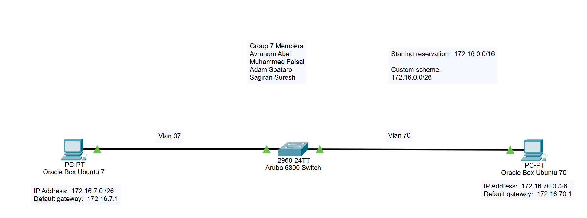

# Aruba 6300 Switch: VLANs, DHCP & SSH
A hands-on networking lab that configures an **Aruba 6300 (AOS-CX) switch** with two VLANs, inter-VLAN routing and an on-switch DHCP server. Two **Ubuntu 22.04 virtual machines**, one per VLAN, receive their addressing from the switch, and end-to-end connectivity is proven with **SSH** sessions captured in **Wireshark**.

-orange)


**Last updated:** November 2026

---

## 📚 Project Objectives
- Design a custom IP scheme by splitting the starting reservation `172.16.0.0/16` into `/26` subnets
- Create **VLAN 7** and **VLAN 70** on the Aruba 6300 and assign one access port to each
- Give each VLAN a gateway (SVI) so the switch routes between them
- Run a **DHCP server on the switch** with one pool per VLAN
- Connect two Ubuntu VMs, one per VLAN, and confirm they receive an address and default gateway from the switch
- Disable direct root login over SSH and connect with SSH between the VMs and to the switch
- Capture the SSH sessions in **Wireshark** and verify the switch with `show` commands

---

## 🗺️ Network Topology


---

## 📂 Repository Layout
```
Aruba-6300-Switch-VLANs-DHCP-and-SSH/
├── configs/
│   ├── aruba-6300-switch.cfg        # Switch configuration (VLANs, SVIs, DHCP, ports)
│   └── sshd_config.snippet          # The sshd_config change made on the VMs
├── docs/
│   ├── topology.md                  # Addressing plan and design notes
│   ├── setup.md                     # Step-by-step build guide
│   ├── verification.md              # Every check, with expected output
│   └── submission.md                # Project summary and references
├── packet-tracer/
│   └── network-diagram.pkt           # Network diagram (Cisco Packet Tracer)
├── screenshots/                     # Proof of each deliverable
├── scripts/
│   └── verify-connectivity.bash     # Optional helper to run the VM-side checks
├── .gitignore
└── README.md
```

---

## 🧰 Requirements
- Aruba 6300 switch running AOS-CX (CLI prompt `6300#`)
- Two Ubuntu 22.04 VMs (built in VMware Workstation), each with:
  - `ens33` – uplink to the campus network (DHCP)
  - `ens37` – connected to the Aruba switch
- `openssh-server` and `openssh-client` installed on both VMs
- Wireshark on the VMs for packet capture
- Cisco Packet Tracer to open the `.pkt` diagram

---

## ⚙️ Setup

Full walkthrough: [docs/setup.md](docs/setup.md). The short version:

1. Paste the switch configuration from [configs/aruba-6300-switch.cfg](configs/aruba-6300-switch.cfg) into the Aruba CLI.
2. Connect VM 1 (`ens37`) to port `1/1/1` and VM 2 (`ens37`) to port `1/1/2`.
3. On each VM, confirm the interface received an address from the switch:

   ```bash
   ip -brief link
   ip a
   ```

4. Disable root login in `/etc/ssh/sshd_config` and restart SSH:

   ```bash
   sudo vim /etc/ssh/sshd_config      # set: PermitRootLogin no
   sudo systemctl restart ssh
   ```

5. Create a key pair on each VM and copy the public key to the other VM:

   ```bash
   ssh-keygen
   ssh-copy-id <username>@<other-vm-ip>
   ```

6. Test SSH to the other VM and to the switch gateway:

   ```bash
   ssh <username>@172.16.70.9
   ssh student@172.16.7.1
   ```

---

## 🖥️ Switch Configuration

The full file lives in [configs/aruba-6300-switch.cfg](configs/aruba-6300-switch.cfg). Highlights:

```
dhcp-server vrf default
    pool vlan7
        range 172.16.7.1 172.16.7.62
        default-router 172.16.7.1
        exit
    pool vlan70
        range 172.16.70.1 172.16.70.63
        default-router 172.16.70.1
        exit
    enable

vlan 7
 exit
vlan 70
 exit
interface vlan 7
    ip address 172.16.7.1/26
    no shutdown
interface vlan 70
    ip address 172.16.70.1/26
    no shutdown

interface 1/1/1
    no shutdown
    no routing
    vlan access 7
    exit
interface 1/1/2
    no shutdown
    no routing
    vlan access 70
    exit
```

---

## ✅ Usage & Verification

Every check below has expected output and a screenshot in [docs/verification.md](docs/verification.md).

**On the switch**

```
6300# sh ip int br
Interface         IP Address            Interface Status
                                        link/admin
vlan1             No Address            down/up
vlan7             172.16.7.1/26         up/up
vlan70            172.16.70.1/26        up/up
```

```
6300# show vlan
VLAN  Name             Status  Reason                Type     Interfaces
1     DEFAULT_VLAN_1   down    no_member_forwarding  default  1/1/3-1/1/24,1/1/27-1/1/28
7     VLAN7            up      ok                    static   1/1/1
70    VLAN70           up      ok                    static   1/1/2
```

**On a VM** (VLAN 70 example, excerpt)

```
$ ip a
3: ens37: <BROADCAST,MULTICAST,UP,LOWER_UP> ...
    inet 172.16.70.9/26 brd 172.16.70.63 scope global dynamic noprefixroute ens37

$ ip route
default via 172.16.70.1 dev ens37 proto dhcp metric 20101
172.16.7.0/26 via 172.16.70.1 dev ens37
172.16.70.0/26 dev ens37 proto kernel scope link src 172.16.70.9 metric 101
```

**SSH between VLANs** – the VMs log in to each other across the switch, and Wireshark shows the SSHv2 handshake (version exchange, key exchange init, Elliptic Curve Diffie-Hellman).

---

## 🔍 How It Works
1. **VLANs** – Ports `1/1/1` and `1/1/2` are access ports (`no routing`, `vlan access N`), so each VM sits in its own Layer 2 broadcast domain.
2. **Routing** – `interface vlan 7` and `interface vlan 70` are switch virtual interfaces. Their addresses (`.1`) are the default gateways, and the switch routes between the two `/26` networks.
3. **DHCP** – The switch's DHCP server hands each VM an address, mask and `default-router` from the pool matching its VLAN. `show dhcp-server leases` lists the active leases.
4. **Routes on the VMs** – Each VM also has a second NIC (`ens33`) on the campus network, which wins the default route by metric. A static route to the other VLAN via the local gateway lets traffic cross the switch.
5. **SSH** – The VMs set `PermitRootLogin no` and use an `ssh-keygen` key pair for each user (the VM-to-VM logins in the screenshots complete without a password prompt). The switch also accepts SSH on its VLAN gateway addresses, where the `student` account is prompted for a password. Wireshark on `ens37` captures the sessions.
6. **Spanning tree** – The switch runs MSTP and is the root bridge. Only the two connected ports are forwarding.

---

## 🖼️ Screenshots
| # | Screenshot | File |
|---|------------|------|
| 1 | Network diagram | [01-network-diagram.png](screenshots/01-network-diagram.png) |
| 2 | SSH to the switch from the VLAN 70 VM (Wireshark) | [02-ssh-to-switch-vlan70-wireshark.png](screenshots/02-ssh-to-switch-vlan70-wireshark.png) |
| 3 | SSH to the switch from the VLAN 7 VM (Wireshark) | [03-ssh-to-switch-vlan7-wireshark.png](screenshots/03-ssh-to-switch-vlan7-wireshark.png) |
| 4 | SSH VLAN 7 VM → VLAN 70 VM | [04-ssh-vm-to-vm-vlan7-to-vlan70.png](screenshots/04-ssh-vm-to-vm-vlan7-to-vlan70.png) |
| 5 | SSH VLAN 70 VM → VLAN 7 VM | [05-ssh-vm-to-vm-vlan70-to-vlan7.png](screenshots/05-ssh-vm-to-vm-vlan70-to-vlan7.png) |
| 6 | `ip a` on the VLAN 70 VM | [06-ip-a-vlan70-vm.png](screenshots/06-ip-a-vlan70-vm.png) |
| 7 | `ip a` on the VLAN 7 VM | [07-ip-a-vlan7-vm.png](screenshots/07-ip-a-vlan7-vm.png) |
| 8 | `ip route` on the VLAN 70 VM | [08-ip-route-vlan70-vm.png](screenshots/08-ip-route-vlan70-vm.png) |
| 9 | `ip route` on the VLAN 7 VM | [09-ip-route-vlan7-vm.png](screenshots/09-ip-route-vlan7-vm.png) |
| 10 | `sshd_config` change | [10-sshd-config.png](screenshots/10-sshd-config.png) |
| 11 | `sh ip int br` | [11-show-ip-interface-brief.png](screenshots/11-show-ip-interface-brief.png) |
| 12–13 | `sh spanning-tree` | [12](screenshots/12-show-spanning-tree-part1.png) · [13](screenshots/13-show-spanning-tree-part2.png) |
| 14 | `show vlan` | [14-show-vlan.png](screenshots/14-show-vlan.png) |
| 15 | `sh dhcp-server leases` | [15-show-dhcp-server-leases.png](screenshots/15-show-dhcp-server-leases.png) |
| 16 | Switch configuration script | [16-switch-configuration.png](screenshots/16-switch-configuration.png) |

---

## 📖 References
- [ArubaOS 8.x CLI Reference Guide](https://arubanetworking.hpe.com/techdocs/ArubaOS-8.x-Books/ArubaOS-8.x-CLI-Reference-Guide.pdf)
- [HPE Support – document a00021327en_us](https://support.hpe.com/hpesc/public/docDisplay?docId=a00021327en_us)
- [HPE Support – document a00055715en_us](https://support.hpe.com/hpesc/public/docDisplay?docId=a00055715en_us&docLocale=en_US)
