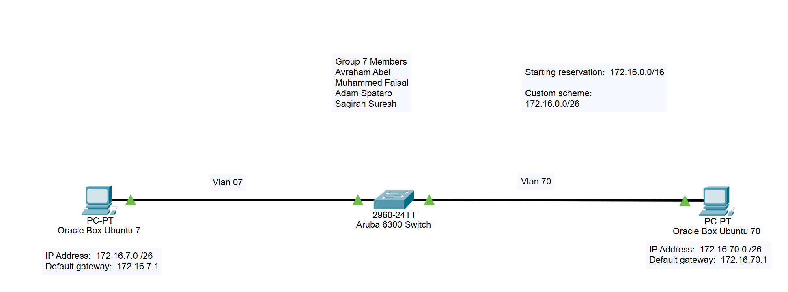

# 🗺️ Topology & Addressing Plan

This document describes the network designed for this lab.

The editable diagram is in [`packet-tracer/network-diagram.pkt`](../packet-tracer/network-diagram.pkt) (open with Cisco Packet Tracer).

---

## Devices

| Device | Role | Notes |
|--------|------|-------|
| Aruba 6300 switch | Layer 3 switch, DHCP server, SSH server | Drawn as a 2960-24TT icon in Packet Tracer |
| Ubuntu VM (VLAN 7) | Client | Ubuntu 22.04.5 LTS, VMware Workstation |
| Ubuntu VM (VLAN 70) | Client | Ubuntu 22.04.5 LTS, VMware Workstation |

---

## Addressing Scheme

- **Starting reservation:** `172.16.0.0/16`
- **Custom scheme:** `/26` subnets (64 addresses each, 62 usable hosts)
- The VLAN number is used as the third octet, which makes each network easy to recognise.

| VLAN | Name   | Network          | Netmask           | Gateway (SVI)  | Broadcast       |
|------|--------|------------------|-------------------|----------------|-----------------|
| 7    | VLAN7  | `172.16.7.0/26`  | `255.255.255.192` | `172.16.7.1`   | `172.16.7.63`   |
| 70   | VLAN70 | `172.16.70.0/26` | `255.255.255.192` | `172.16.70.1`  | `172.16.70.63`  |

---

## Switch Ports

| Port    | Mode   | VLAN | Connected to          |
|---------|--------|------|-----------------------|
| `1/1/1` | Access | 7    | Ubuntu VM (VLAN 7)    |
| `1/1/2` | Access | 70   | Ubuntu VM (VLAN 70)   |

All other ports are disabled and part of the default VLAN 1 (see `show vlan` in [verification.md](verification.md)).

---

## VM Network Interfaces

Each VM has two network adapters:

| Interface | Purpose | Addressing |
|-----------|---------|------------|
| `ens33` | Uplink to the campus network | DHCP (`10.33.35.0/24`) |
| `ens37` | Link to the Aruba switch | DHCP from the switch pool |

Because `ens33` has the lower route metric (100), it holds the preferred default route. Each VM therefore has a static route to the other VLAN through its local gateway on `ens37`:

| VM | Route to the other VLAN |
|----|-------------------------|
| VLAN 7 VM (`172.16.7.37`) | `172.16.70.0/26 via 172.16.7.1 dev ens37` |
| VLAN 70 VM (`172.16.70.9`) | `172.16.7.0/26 via 172.16.70.1 dev ens37` |

---

## DHCP Leases Observed

From `sh dhcp-server leases` on 16 May 2025:

| IP Address     | Hostname            | Notes |
|----------------|---------------------|-------|
| `172.16.7.37`  | `csp450`            | Ubuntu VM, VLAN 7 |
| `172.16.70.9`  | `ubuntuvm`          | Ubuntu VM, VLAN 70 |
| `172.16.7.30`  | `NHK1270-19-E063`   | Lab PC on the same VLAN |
| `172.16.70.48` | `NHK1270-20-E1C2`   | Lab PC on the same VLAN |

---

## Design Notes

- The pools are `172.16.7.1 – 172.16.7.62` and `172.16.70.1 – 172.16.70.63`, exactly as configured in the project. Both include the gateway address, and the VLAN 70 pool ends on the broadcast address. A tidier pool would be `.2 – .62` in each VLAN.
- Spanning tree runs in MSTP mode and the switch is the root bridge (priority 32768).
